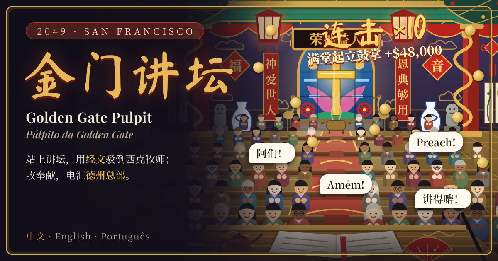

# 金门讲坛 · Golden Gate Pulpit · 2049

**在线玩 / Play / Jogar:** https://jabarrick.github.io/golden-gate-pulpit/

2049 年的旧金山，站在美国讲坛上的多半是华人牧师。你是华埠金门恩典堂的李约翰牧师：每个主日从几节圣经原文里挑出真正对得上的那一节，驳倒海湾对面宣讲白人至上的西克牧师；然后收奉献，决定把多少钱电汇给德克萨斯州的总部，多少留给华埠。

San Francisco, 2049. Most American pulpits are now filled by Chinese pastors. You are Pastor John Li of Golden Gate Grace Church in Chinatown: each Sunday you pick, from several real Bible verses, the one that actually answers the white-supremacist Pastor Sick across the bay. Then you take the offering and decide how much to wire to headquarters in Texas and how much stays in Chinatown.

São Francisco, 2049. A maior parte dos púlpitos americanos é hoje ocupada por pastores chineses. Tu és o pastor John Li, da Igreja da Graça da Golden Gate, em Chinatown: todos os domingos escolhes, entre vários versículos verdadeiros, o único que responde ao pastor Sick, supremacista branco do outro lado da baía. Depois recolhes a oferta e decides quanto envias para a sede no Texas e quanto fica em Chinatown.

- 30 claims, 70 Bible verses (Chinese Union Version / KJV / Almeida), combo tips when the hall stands to applaud
- A first-person view from the pulpit, with 31 pieces of Chinese decor that appear in the sanctuary
- 16 staff to appoint, paid for in headquarters favour, including a resistance leader who rallies the flock against capitalists and loan companies
- A Navy draft every two months: the flock pays to be spared, half are taken, and you decide how much of the money goes to Texas
- 9 endings, an in-game wiki and debug tools
- A keepsake photo of your church, downloadable as a PNG
- 中文 / English / Português, playable on one phone screen
- One self-contained `index.html`; no build step, no dependencies

A work of satirical fiction. All people, churches and organisations are invented. Bible verses were written out from memory and have not been checked verse by verse against printed editions.
